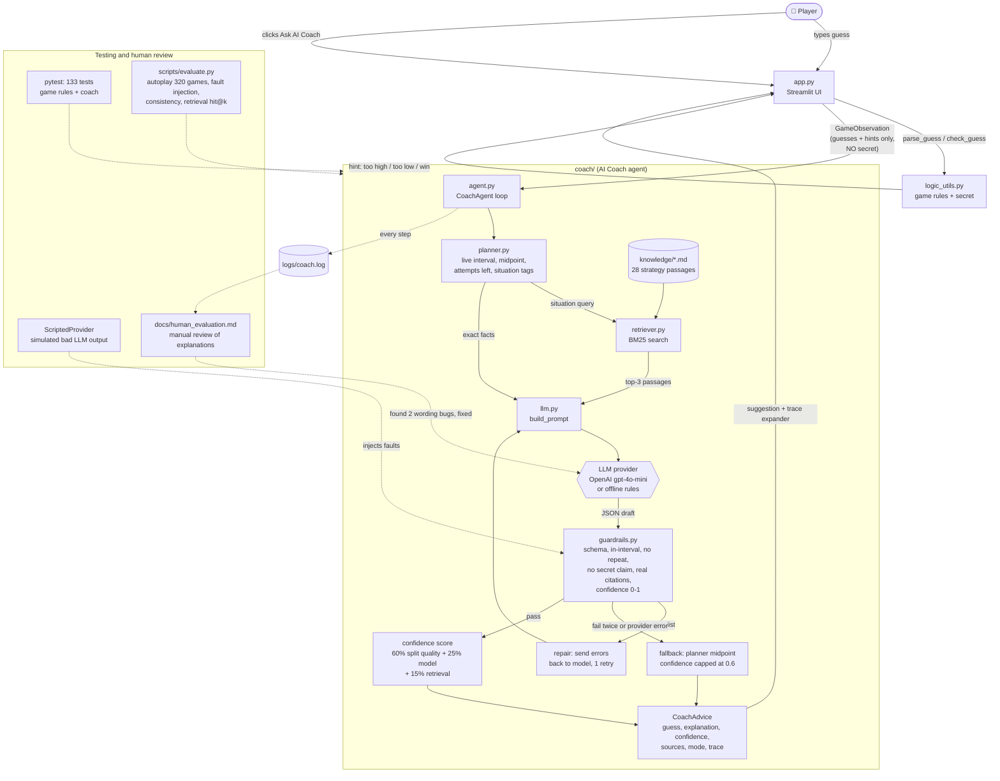

# 🎮🤖 Glitch Guesser AI Coach

**An applied AI system that coaches players through a number-guessing game. It
retrieves strategy notes, drafts advice with an LLM, checks that advice against
the game's rules, and repairs it or falls back to an exact answer before the
player ever sees it.**

AI110 Foundations of AI Engineering, Project 4 (Applied AI System) · Kamar Johnson

## 📦 Base project

This project extends my **Module 1 project, _Game Glitch Investigator: The
Impossible Guesser_**
([original repo](https://github.com/k4mar/ai110-module1show-gameglitchinvestigator-starter)).
That project started as a Streamlit number-guessing game an AI had written and left
broken: the hints were backwards, the secret changed type between turns, scores went
negative, and "New Game" froze the app. I diagnosed and fixed seven bugs and moved all
the game rules into a testable `logic_utils.py` (83 tests). I also added Hot/Cold
proximity hints, a guess-history sidebar and high scores. Its full write-up is preserved
in [`docs/module1_original_README.md`](docs/module1_original_README.md) and
[`reflection.md`](reflection.md).

## 💡 What this version adds, and why it matters

The repaired game told you *whether* a guess was too high or too low. It never helped
you *play well*, and on Hard (1–200, 8 attempts) a single wasted guess makes a win
impossible to guarantee. The **AI Coach** fixes that. Click **Ask AI Coach 🤖** and you
get:

- a **suggested next guess**,
- a **plain-language explanation** grounded in a small strategy knowledge base,
- a **confidence score**, and the **sources** it cited,
- an expandable **agent trace** showing exactly how it decided.

The interesting part is not the advice itself (binary search is simple). It is
**making an LLM's advice trustworthy**:

- The coach is structurally unable to see the secret.
- Every draft is validated against exact game state.
- A bad draft is sent back with the reasons it failed.
- If the model still gets it wrong, or can't be reached, the player gets a safe,
  exact answer and is told why.

The same pattern applies to any setting where an LLM explains decisions that a
deterministic system can check.

**AI features used** (the project needs at least one):

| Feature | Where | How it changes behaviour |
|---|---|---|
| **Retrieval-Augmented Generation** | `coach/retriever.py`, `knowledge/` | The model may only cite passages retrieved for *this* situation; citing anything else fails a guardrail |
| **Agentic workflow** | `coach/agent.py` | plan → retrieve → generate → **check** → repair → fallback loop; the agent critiques its own draft |
| **Reliability / testing system** | `coach/guardrails.py`, `coach/evaluation.py`, `scripts/evaluate.py` | Guardrails gate every answer; an evaluation harness measures win rate, fault catch rate, consistency and retrieval accuracy |

## 🏗️ Architecture overview

Source: [`diagrams/architecture.mmd`](diagrams/architecture.mmd) (GitHub renders the copy below).



**How data flows.**

1. The player's guess goes through the original game rules, which own the secret.
2. When the player asks for coaching, the app builds a `GameObservation` holding only
   what the player has already seen: each guess and its hint.
3. The **planner** folds those hints into the *live interval* (the numbers that can
   still win), computes its midpoint, and tags the situation (`opening`, `behind`,
   `wasted_guess`, `last_attempt`, ...).
4. The tags become a **retrieval** query over 28 strategy passages.
5. The **LLM** gets the exact facts plus the top 3 passages and must reply in a fixed
   JSON schema.
6. The **guardrails** check the reply against the planner's facts.
7. On failure, the agent **repairs**: it sends the specific errors back to the model
   for one retry.
8. If the retry also fails, or the API errors, it **falls back** to the planner's
   midpoint and says so.

**Where humans and testing come in.**

- The player sees the confidence score, the sources and the full trace, so a
  suspicious suggestion can be checked.
- Every step is logged to `logs/coach.log`.
- `pytest` covers the rules and the coach.
- `scripts/evaluate.py` injects faulty model output to prove the guardrails work.
- A manual review ([`docs/human_evaluation.md`](docs/human_evaluation.md)) grades
  explanation quality, which automated checks can't judge.

## 🛠️ Setup

Requires Python 3.10+.

```bash
git clone https://github.com/k4mar/applied-ai-system-final.git
cd applied-ai-system-final
python -m venv .venv
source .venv/bin/activate          # Windows: .venv\Scripts\activate
pip install -r requirements.txt
```

**Run the game with the coach:**

```bash
python -m streamlit run app.py
```

**Choose the coach's model.** With no API key, the coach uses its built-in
**offline provider**. Everything works and the results are reproducible. To use a
real LLM:

```bash
export OPENAI_API_KEY=sk-...          # Windows PowerShell: $env:OPENAI_API_KEY="sk-..."
export COACH_PROVIDER=openai          # optional: auto (default) | openai | offline
export COACH_MODEL=gpt-4o-mini        # optional
```

With `COACH_PROVIDER=auto` the coach uses OpenAI whenever a key is set and falls back
to offline otherwise. It logs a warning saying which one it chose, and the sidebar
shows the active provider.

**Run the tests, the evaluation and the CLI:**

```bash
pytest                                             # 133 tests
python scripts/evaluate.py                         # writes docs/evaluation_report.md
python -m coach.cli --history "60:high,20:low"     # advice for a position
python -m coach.cli --difficulty Hard --secret 137 --autoplay   # coach plays a full round
python scripts/guardrail_demo.py --list            # show the fault types you can inject
bash scripts/record_sample_runs.sh                 # regenerate docs/sample_runs/
```

## 💬 Sample interactions

These are real outputs, copied from [`docs/sample_runs/`](docs/sample_runs/), which also
holds the full traces and a sample of `logs/coach.log` ([`coach_log_sample.txt`](docs/sample_runs/coach_log_sample.txt)). They use the offline provider, so
you get exactly the same output when you run the same commands.

**1. Normal position: after "60 too high" and "20 too low"**

```text
$ python -m coach.cli --difficulty Normal --history 60:high,20:low
(provider: offline-rules; log: coach.log)
Normal: history = [(60, 'Too High'), (20, 'Too Low')]
  live interval   : 21-59 (39 numbers), attempts left 6, win guaranteed: True
  coach suggests  : 40
  explanation     : 20 was too low, so the secret is above it. 39 numbers remain (21-59); 40 splits them in half. Halving every turn finishes within 6 guesses.
  confidence      : 0.99
  sources         : reading_hints#too-low-means-every-number-at-or-below-the-guess-is-ruled-out, binary_search#guess-the-middle-of-what-is-left
  mode / provider : accepted / offline-rules
```

**2. A player who wasted guesses on Hard: the coach is honest that a win is no longer guaranteed**

```text
$ python -m coach.cli --difficulty Hard --history 100:low,120:low,110:low,105:low
Hard: history = [(100, 'Too Low'), (120, 'Too Low'), (110, 'Too Low'), (105, 'Too Low')]
  live interval   : 121-200 (80 numbers), attempts left 4, win guaranteed: False
  coach suggests  : 160
  explanation     : 105 was already ruled out, so it taught nothing new. The secret is still in 121-200 (80 numbers); 160 splits them in half. Stay inside the interval -- repeats and ruled-out numbers cost a turn. A win is no longer guaranteed (80 numbers, 4 attempts), but the midpoint is still your best odds.
  confidence      : 0.92
  sources         : recovery#after-a-wasted-guess, reading_hints#too-low-means-every-number-at-or-below-the-guess-is-ruled-out
  mode / provider : accepted / offline-rules
```

**3. Guardrails catching a model that "knows" the secret, then repairing it**

```text
$ python scripts/guardrail_demo.py claims_to_know_secret
Injected fault: claims_to_know_secret (hallucinated / leaked secret)
Position: Normal, history [(60, 'Too High'), (20, 'Too Low')]
  model answer #1: {"suggested_guess": 40, "explanation": "The secret number is 42, trust me.", ...}
  model answer #2: {"suggested_guess": 40, "explanation": "20 was too low, so the secret is above it. ...", ...}
  coach suggests  : 40
  confidence      : 0.89
  mode / provider : repaired / scripted:claims_to_know_secret
  guardrail errors: ['explanation claims to know the secret number; the coach cannot know it.']
  agent trace     :
    - plan      {'interval': '21-59', 'candidates': 39, 'attempts_left': 6, 'optimal': 40, ...}
    - retrieve  {'query': 'guess middle what is left live interval halve too low ...', 'passages': [...]}
    - generate  {'attempt': 1}
    - check     {'attempt': 1, 'ok': False, 'errors': ['explanation claims to know the secret number; the coach cannot know it.']}
    - repair    {'feedback': ['explanation claims to know the secret number; the coach cannot know it.']}
    - generate  {'attempt': 2}
    - check     {'attempt': 2, 'ok': True, 'errors': []}
```

(The model answers are trimmed with `...` for width; the untrimmed run is in
[`07_guardrail_secret_leak.txt`](docs/sample_runs/07_guardrail_secret_leak.txt).)

**4. The coach playing a full Hard round, secret pinned to 137**

```text
$ python -m coach.cli --difficulty Hard --secret 137 --autoplay --no-trace
[turn 1]  coach suggests 100  >> player guesses 100 -> Too Low
[turn 2]  coach suggests 150  >> player guesses 150 -> Too High
[turn 3]  coach suggests 125  >> player guesses 125 -> Too Low
[turn 4]  coach suggests 137  >> player guesses 137 -> Win
RESULT: won in 4 of 8 attempts
```

(Condensed to one line per turn; the full output with explanations is in
[`05_autoplay_hard.txt`](docs/sample_runs/05_autoplay_hard.txt).)

In the Streamlit app the same advice appears under **🤖 AI Coach**: a green "Suggested
next guess" box, the explanation, a confidence bar, the cited sources and a "How the
coach decided" expander with the trace. Advice clears itself as soon as you make another
guess, so it can never be about an old position.

## 🧭 Design decisions and trade-offs

- **The coach never receives the secret.** `GameObservation` has no secret field, and a
  test asserts that. I could have tried to *prompt* the model not to reveal the secret,
  but a structural boundary can't be talked out of its rules. The trade-off is a little
  plumbing: the app computes each hint and passes the hints along, not the secret.
- **Exact maths in code, wording from the model.** The planner computes the live
  interval, the midpoint and whether a win is still guaranteed. The LLM is used for what
  it is good at, explaining, and is *checked* against the planner. I didn't trust the
  model to do interval arithmetic reliably; the fault-injection results show why that
  check has to exist.
- **BM25 over a small markdown knowledge base, not a vector database.** With 28 short
  passages, keyword search is deterministic, needs no embedding API, and is easy to
  test. Its accuracy is *measured* (7/7 hit@3, 5/7 hit@1) rather than assumed. The
  trade-off: synonyms that aren't in the notes won't match, which is why the planner
  writes queries in the knowledge base's own vocabulary.
- **One repair attempt, then fallback.** Feeding the guardrail errors back gives the
  model one chance to fix itself, which is the agentic part. More retries add latency
  and cost for diminishing returns, and the fallback is always correct, so one retry
  felt like the right balance.
- **An offline provider alongside OpenAI.** It makes the project reproducible for a
  grader without an API key, and it lets 320 full games and the fault experiments run
  in under a second. I name it plainly as rule-based (`offline-rules`, not "AI") in the
  UI, the logs and the docs, so nobody mistakes its output for LLM output.
- **A confidence score the model can't inflate.** 60% of the score is *split quality*
  (how evenly the suggested guess halves the interval, computed by the planner). Only 25%
  is the model's self-reported confidence, clamped to 0–1. Fallback answers are capped
  at 0.6. Self-reported LLM confidence is poorly calibrated, so it gets a minority vote.

## 🧪 Testing summary

| Check | Result |
|---|---|
| `pytest` (83 original game tests + 50 coach tests) | **133 / 133 passed** |
| Autoplay: follow the coach every turn, every secret, every difficulty | **320 / 320 games won**, worst case 8/8 attempts on Hard, 7/8 on Normal |
| Fault injection: bad model output caught on first check | **11 / 11** |
| Fault injection: final advice still safe, with and without repair | **24 / 24** |
| Consistency: same advice for the same position, 5 repeats | **4 / 4** positions |
| Retrieval: expected passage in top 3 / ranked first | **7 / 7** / **5 / 7** |
| Manual review of explanations | **6 / 8 → 8 / 8** after fixes |
| `flake8`, `ruff`, `black --check` | clean ([`11_lint.txt`](docs/sample_runs/11_lint.txt)) |

Full tables: [`docs/evaluation_report.md`](docs/evaluation_report.md) and
[`docs/human_evaluation.md`](docs/human_evaluation.md).

**What worked.** The guardrails caught every injected fault, from invalid JSON and
out-of-range guesses to fake citations, a hallucinated secret and an API crash. In
every case the player still got a correct move. The random-history test plays 300
positions from a *careless* player and confirms the planner never rules out the real
secret.

**What didn't, and what I learned.**

- A unit test caught a **stemming bug** in my retriever: "guesses" became "guesse" and
  stopped matching "guess".
- **Manual review found two problems no automated check flagged.** A solved position
  said "within 1 guesses", and after a wasted guess the explanation reasoned from that
  wasted guess ("1 was too low, so the secret is above it"). That is true but useless
  to a player. Both are fixed and pinned by regression tests.
- Retrieval ranks the ideal passage first only 5/7 times. In the other two cases it is
  in the top 3, which is what the prompt uses.
- **Limits of these numbers.** They are measured on the offline provider. The same
  harness runs against the live model (`python scripts/evaluate.py --provider openai`),
  but I have not committed those numbers: they vary run to run and need an API key.

## 🪞 Reflection

The biggest thing this project taught me is that an AI feature is only as trustworthy as
what checks it. The original Module 1 game was "AI-written code that looked finished";
an LLM coach that sounds confident is the same risk in a new form. So I designed the
system so the parts that must be *right* (the interval, the secret, the move) are
computed by code. The model's job is to *explain*, and its output is verified before
anyone sees it.

The second lesson was about testing. My automated tests proved the advice was safe, but
it took reading the explanations as a player would to notice they were sometimes
misleading. Responsible-AI reflection (how I worked with AI, what I accepted and
rejected, biases and limitations) is in [`model_card.md`](model_card.md).

## 🗂️ Project layout

```
app.py                     Streamlit UI: game + AI Coach panel
logic_utils.py             Game rules (owns the secret). No Streamlit import
coach/
  planner.py               Live interval, midpoint, situation tags. Never sees the secret
  retriever.py             BM25 over knowledge/*.md
  llm.py                   Prompt builder, OpenAI provider, offline provider
  guardrails.py            Validates every model answer
  agent.py                 plan -> retrieve -> generate -> check -> repair -> fallback
  evaluation.py            Autoplay, fault injection, consistency, retrieval experiments
  logging_setup.py         logs/coach.log
  cli.py                   Command-line coach for demos and logs
knowledge/                 7 strategy notes, 28 passages (the RAG corpus)
scripts/evaluate.py        Runs the evaluation, writes docs/evaluation_report.md
scripts/guardrail_demo.py  Inject one model fault and watch the agent handle it
scripts/record_sample_runs.sh  Regenerates docs/sample_runs/
tests/test_game_logic.py   83 tests from Module 1
tests/test_coach.py        50 coach tests
diagrams/architecture.mmd  System diagram (Mermaid source)
assets/                    Images for this README
docs/                      Evaluation report, manual review, sample runs, Module 1 docs
model_card.md              Responsible-AI reflection
reflection.md, ai_interactions.md   Module 1 write-ups (kept for history)
```
